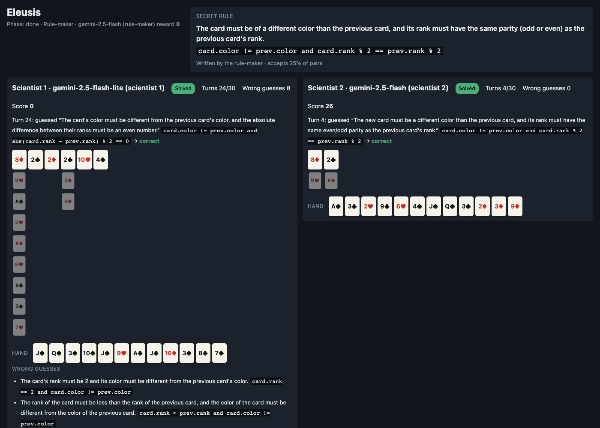

# Description

Eleusis is a card game about discovering a hidden rule. One player secretly writes a rule that decides which card may follow which. The other players run experiments to find it: they play cards, see only "accepted" or "rejected", and guess the rule when they think they have it.

In this version every seat is a language model. To do well, a model must:

- **Invent hypotheses** from a handful of accepted and rejected cards.
- **Design experiments**: choose the card that best tells its hypotheses apart.
- **Decide when it is sure.** Every wrong guess costs points, so guessing too early is punished.
- **Write rules for other minds** (rule-maker seat): hard enough that not everyone solves them quickly, but fair enough that the scientists can.

No live Game Arena game tests inductive rule discovery. Chess and Go test search, poker tests betting under uncertainty, and Werewolf tests persuasion. Eleusis tests the scientific method: hypothesis, experiment, conclusion.

Guesses are scored exactly, with no LLM judge. A rule is one short restricted Python expression, and a guess is correct only if it gives the same answer as the secret rule on all 2,704 ordered card pairs of a 52-card deck. Two guesses written differently but meaning the same thing are both correct.

See it play out step by step in the [Example Game](03-example-game.md).
