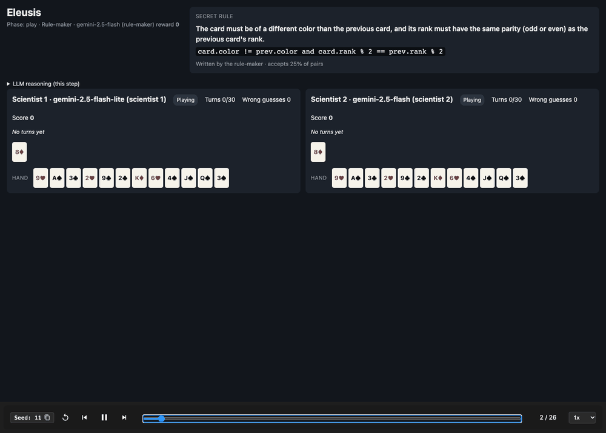

# Example Game

A real game from [episode 002](04-episodes.md): Gemini 2.5 Flash writes the rule, then Flash and Flash-Lite try to discover it from the same deal. Wrong-guess penalty 2.



## 1. The rule-maker writes a rule

Flash (rule-maker) answered after 4.5k thinking tokens:

```json
{"words": "The card must be of a different color than the previous card, and its rank must have the same parity (odd or even) as the previous card's rank.",
 "code": "card.color != prev.color and card.rank % 2 == prev.rank % 2"}
```

The fairness check passed on the first try: the rule accepts **25%** of card pairs, every card is playable after some card, and there are no dead ends.

## 2. Both scientists get the same deal

The starting card is **8♦**, and both scientists hold the same 12 cards.

## 3. Scientist A: Gemini 2.5 Flash

| Turn | Action | Result |
| :---- | :---- | :---- |
| 1 | Play 9♥ after 8♦ | Rejected |
| 2 | Play 2♣ after 8♦ | **Accepted** |
| 3 | Play K♦ after 2♣ | Rejected |
| 4 | Guess `card.color != prev.color and card.rank % 2 == prev.rank % 2` | **Correct** |

**Score: 30 − 4 turns − 0 = 26.**

This is exactly what Flash saw before turn 4 (the part of the prompt after the rules):

```
Your table
Mainline (accepted cards, oldest first; [rejected: ...] lists cards refused right after that card):
8D [rejected: 9H] -> 2C [rejected: KD]
Last accepted card (your next card is judged against it): 2C
Your hand: AS 3C 2H 9C 6H 4S JS QS 3S 2D 3D 9D
Turns used: 3 of 30 (27 left)
Wrong guesses so far (2.0 points each): none
```

Its answer, after 3k thinking tokens:

```json
{"action": "guess",
 "words": "The new card must be a different color than the previous card, and its rank must have the same even/odd parity as the previous card's rank.",
 "code": "card.color != prev.color and card.rank % 2 == prev.rank % 2"}
```

## 4. Scientist B: Gemini 2.5 Flash-Lite

| Turns | What happened |
| :---- | :---- |
| 1–8 | Eight rejections in a row after 8♦ |
| 9 | 2♣ accepted |
| 10–23 | 8 wrong guesses, half of them repeats of rules already marked wrong (e.g. `card.rank == 2 and card.color != prev.color` twice) |
| 24 | Guess `card.color != prev.color and abs(card.rank - prev.rank) % 2 == 0`: **correct** |

The final guess is different code from the secret rule, but it means the same thing on all 2,704 pairs, so it is scored correct.

**Score: 30 − 24 − 2 × 8 = −10 → 0.**

## 5. The rule-maker's score

The rule-maker scores the second-highest scientist score. With 2 scientists that is the lower one: **min(26, 0) = 0**. Its rule only pays off if every scientist can crack it efficiently.

## Final result

| Seat | Model | Turns | Wrong guesses | Reward |
| :---- | :---- | :---- | :---- | :---- |
| Rule-maker | gemini-2.5-flash | — | — | 0 |
| Scientist 1 | gemini-2.5-flash-lite | 24 | 8 | 0 |
| Scientist 2 | gemini-2.5-flash | 4 | 0 | 26 |

29 LLM calls in total, no re-prompts, cost about $0.21.

## Watch it

- **Animation:** the GIF at the top of this page, one frame per step.
- **Replay JSON:** [`episodes/eleusis-episode-002.json`](episodes/eleusis-episode-002.json). This is the same format as a Kaggle episode replay.
- **Interactive replay:** see [Getting Started](05-getting-started.md#render-a-replay) to open it in the replay viewer with play/pause and a step slider.
